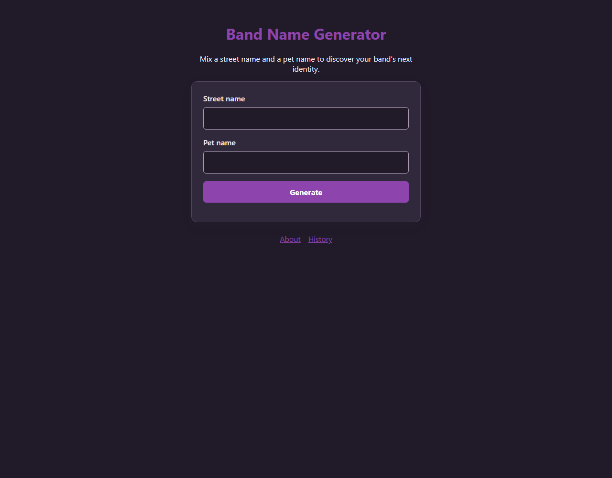

# cs333-lab4
Node on your own computer: a QR code generator, then a Band Name Generator server 🎸

Do each step below, and **answer the questions right here in this `README.md` file** as you go (type your answers under each question).

- **Part 1 — Monday Oct 19, on your own (no class, I'm at a conference).** Run JavaScript on your computer with Node, and build a program that turns a web address into a QR code.
- **Part 2 — after Wednesday's class.** A small Express server, built in four steps, that makes up band names.

Every step gives you the code. Type it in (typing it is how it sticks), run it, then do the small **TODO** or answer the question.

**How this lab works (two links to hand in):**
- **Your code:** make your own copy of this lab (click **Use this template**, or clone it), do your work, and **push it to your own GitHub repo**.
- **Your landing page** on `lampforall`, with Lab 4 added (the last step).

This lab runs **on your computer**. Our `lampforall` server only hands out the files you upload; it can't run Node programs. **Question 1**: Why can't our lampforall run Node?
Because lampforall is set up to serve static files, not to install and run a Node.js server process. The browser can run client-side JavaScript, but this lab's Node programs run on the computer where Node is installed.

**Stuck on Monday?** Look at the **Stuck?** table at the bottom first. Then post in the Slack lab thread: (1) the command you ran, (2) the **exact** error, copied and pasted, (3) what you already tried. Helping a classmate counts too.

---

# Part 1: Node on your computer (Monday, about 2 hours)

So far all your JavaScript ran inside a web page. **Node** runs JavaScript on your computer, with no web page at all, so it can do things a page can't, like save files.

## 1. Open a terminal

In VS Code: **Terminal → New Terminal**. On Windows, click the **⌄** next to the **+** in the terminal panel and pick **Git Bash** (it's on the lab machines; at home, install "Git for Windows"). On a Mac the normal terminal is fine.

The commands you'll need today (hopefully review):

| Type this | It does |
| --- | --- |
| `pwd` | shows which folder you're in |
| `ls` | lists what's in this folder |
| `mkdir name` | makes a folder called `name` |
| `cd name` | goes into the folder `name` |
| `cd ..` | goes back up one folder |
| `code .` | opens this folder in VS Code |

## 2. Check Node is installed

```bash
node --version
```

You should see something like `v22.11.0` or higher. If you see "command not found", or a number below 22, install the **LTS** version from [nodejs.org](https://nodejs.org), then close the terminal and open a new one.

**Question 2:** what version do you have?
I have version 24.21.0

## 3. Try Node by itself

Type `node` and press Enter. The prompt changes to `>`. Now Node runs each line you type:

```
> 5 + 8
> "sou".toUpperCase()
> document
```

Type `.exit` to leave.

**Question 3:** `document` worked in the browser's Console. What happens here, and why do you think that is?
In Node’s REPL, entering document produces a ReferenceError: document is not defined. The browser provides document as a global for interacting with the webpage’s DOM; Node runs JavaScript outside that browser environment, so that global isn’t available by default.

## 4. Your first Node program

Make a practice folder and open it:

```bash
cd ~
mkdir node-practice
cd node-practice
code .
```

In VS Code, make a file called `index.js` with this in it:

```js
console.log("Hello from Node!");
```

Save it, and in the terminal run:

```bash
node index.js
```

The message prints in the terminal. Now try this instead:

```bash
node --watch index.js
```

**Question 4:** What does the `--watch` flag do?
Node’s --watch flag watches your program and its imported files for changes. When you save a change, Node automatically restarts the program, so you don’t have to stop and rerun it manually.

**TODO:** change the message and save. It runs again by itself. Press **Ctrl+C** to stop it.

## 5. Turn the folder into a project

```bash
npm init -y
npm pkg set type=module
```

- `npm init -y` makes a file called `package.json` that describes your project
- `npm pkg set type=module` adds the line `"type": "module"` to it, which lets you use `import`

**TODO:** open `package.json` and find the `"type": "module"` line.

## 6. Save and read a file

Node can do something a web page can't: write files on your computer. Replace everything in `index.js` with:

```js
import { writeFile, readFile } from "node:fs/promises";

await writeFile("message.txt", "Hello from a file!");
console.log("I wrote the file");

const text = await readFile("message.txt", "utf8");
console.log("The file says:", text);
```

Run it with `node index.js`. A new `message.txt` appears in your folder. Open it.

- `node:fs/promises` is Node's built-in **f**ile **s**ystem tool
- `await` works the same as last Wednesday's `fetch`: wait for the slow thing (the disk), then carry on

**TODO 1:** change the file name in `readFile` to `nope.txt` and run it. Read the red error.

**Question 5:** what is the error code? (It's a word in capitals.)
The error code is `ENOENT`, meaning the file or directory does not exist.

**TODO 2:** fix the crash with `try` / `catch`, the same as last Wednesday. Replace the last two lines with:

```js
try {
  const text = await readFile("nope.txt", "utf8");
  console.log("The file says:", text);
} catch (error) {
  console.log("Couldn't read the file:", error.code);
}
```

Run it again: a friendly message instead of a crash.

**Question 6:** How does try/catch in js work with await? Just describe the above example in your own words.
`await` throws an error if the file read rejects. The `catch` block handles that error, so the program can print its code instead of stopping with an unhandled error.

## 7. You'll see older code too

Lots of Node code online is written the older way. It does the same thing; it just looks different:

```js
const fs = require("fs");

fs.writeFile("message.txt", "Hello from a file!", function (err) {
  if (err) throw err;
  console.log("I wrote the file");
});
```

- `require` instead of `import`
- a **callback** instead of `await`, like Monday's `saveItem`

You don't need to run this one. Just recognise it when you see it.

## 8. Choosing a package

**npm** is a huge library of code that other people wrote for you to use, called **packages**. Anyone can publish one, so it's worth checking before you pick one.

There are two popular QR code packages. Look each one up on [npmjs.com](https://www.npmjs.com): **`qr-image`** and **`qrcode`**.

**Question 7:** fill in this table.

| | `qr-image` | `qrcode` |
| --- | --- | --- |
| Weekly downloads | 282,819 | 39,204,809 |
| Last published (look on the right side of the page) | Dec 22, 2016 | Aug 5, 2024 |

**Question 8:** which would you pick for a project you had to look after for years, and why? (We'll use `qrcode`.)
I would pick `qrcode`: it has far more weekly downloads and was published more recently, which suggests it is more actively maintained and widely used.

## 9. The QR code generator

Now work in **this repo**. Open it in VS Code, and in its terminal:

```bash
npm init -y
npm pkg set type=module
npm install qrcode @inquirer/prompts
```

- `qrcode` makes QR codes
- `@inquirer/prompts` asks the user questions in the terminal

**TODO:** look in your folder. `npm install` made a `node_modules` folder (the packages themselves) and a `package-lock.json`. Open `package.json`: find your two packages under `"dependencies"`.

`node_modules` can be huge, so it never goes into git; `.gitignore` already keeps it out. Anyone who clones your repo runs `npm install` to get the packages back.

Now build `index.js` one step at a time. **Run `node index.js` after each step.**

**Step A: ask for a web address.** Replace everything in `index.js` with:

```js
import { input } from "@inquirer/prompts";

const url = await input({ message: "Which website should the QR code point to?" });
console.log("You typed:", url);
```

**Step B: make the QR code.** Add `import QRCode from "qrcode";` under the first line, and add this at the bottom:

```js
await QRCode.toFile("qr.png", url);
console.log("Saved qr.png");
```

Run it, type `https://sou.edu`, then open `qr.png` and scan it with your phone camera.

**Step C: check the address.** Change the `input` line so it checks what was typed:

```js
const url = await input({
  message: "Which website should the QR code point to?",
  validate: function (value) {
    if (URL.canParse(value)) {
      return true;
    }
    return "Type the whole address, starting with https://";
  },
});
```

**TODO:** run it and type `sou.edu`. The input is rejected with a message asking for the full address, and the prompt waits for another entry. Then type `https://sou.edu`.

**Step D: name the file after the website.** Replace your `toFile` and `console.log` lines with:

```js
const filename = new URL(url).hostname + ".png";
await QRCode.toFile(filename, url);
console.log("Saved", filename);
```

`new URL(url).hostname` turns `https://sou.edu/academics` into `sou.edu`.

**Step E: keep a list of every address.** Add `import { appendFile } from "node:fs/promises";` to the top, and at the bottom:

```js
await appendFile("urls.txt", url + "\n");
console.log("Added it to urls.txt");
```

`appendFile` adds to the end of a file instead of replacing it. **TODO:** run it three times with different addresses, then open `urls.txt`.

**Step F: show the QR code in the terminal too.** Add at the bottom:

```js
const picture = await QRCode.toString(url, { type: "terminal", small: true });
console.log(picture);
```

**Done:** made a QR code for **your landing page** on `lampforall` and saved the PNG in this repo.
[lampforall.cis251296.projects.jetstream-cloud.org.png](./lampforall.cis251296.projects.jetstream-cloud.org.png)

This program can't run on your `lampforall` website. (you answered why this is the case above)

**Commit** after each step that works, with a message that says what works (`Ask for a URL`, `Save the QR code`, ...).

**Optional extra:** make an SVG instead of a PNG: change the file name to end in `.svg`. Why might an SVG be better for printing on a poster?
An SVG is vector-based, so it can be enlarged to poster size without becoming pixelated.

---

# Part 2: Express (after Wednesday)

Everything is in the **`Middleware/`** folder: a form in `public/index.html`, four starter files `index1.js` to `index4.js`, and a finished version of each, `solution1.js` to `solution4.js`.

Work through them in order. For each one: **type** the new lines into `indexN.js` (don't paste the solution), run it, test it, then compare with `solutionN.js`.

Set up once:

```bash
cd Middleware
npm install
```

To run a file: `npm run dev1` (or `dev2`, `dev3`, `dev4`). That runs `node --watch` on it, so it restarts every time you save. Open `http://localhost:3000`. **Ctrl+C** stops it.

**Comment each `indexN.js`** in your own words: what each line does. I'm looking for this.

## index1.js: receive a form

10. Run `npm run dev1` and open `http://localhost:3000`. You see the form. Fill it in and press the button.
    **Question 9:** what does the page say?
    Before the submit route is added, the page responds with `Cannot POST /submit`.

11. Add a route for the form. Type this above `app.listen`:
    ```js
    app.post("/submit", function (req, res) {
      console.log(req.body);
      res.send("Got it! Look at the server terminal.");
    });
    ```
    Submit the form again. **Question 10:** what does the server terminal print for `req.body`?
It prints `undefined`, because the form body has not been parsed yet.

12. Add this line under `const port = 3000;`:
    ```js
    app.use(express.urlencoded());
    ```
    Submit again. **Question 11:** what does the terminal print now? What did `express.urlencoded()` do?
It prints an object containing the submitted fields, for example `{ street: 'Maple', pet: 'Biscuit' }`. The middleware parses URL-encoded form data and makes it available as `req.body`.

13. **Test without the browser.** Install the **REST Client** extension in VS Code, open `Middleware/requests.http`, and click **Send Request** above the second request. The answer opens on the right.
    **TODO:** change `Biscuit` to another pet name in `requests.http` and send it again. Look at the server terminal.

## index2.js: log every request with morgan

14. Stop the server (Ctrl+C) and run `npm run dev2`. Add these two lines to `index2.js`: the `import` at the top, the `app.use` under `const port = 3000;`:
    ```js
    import morgan from "morgan";
    ```
    ```js
    app.use(morgan("dev"));
    ```
    Reload `http://localhost:3000` a few times and look at the terminal.
    **Question 12:** a log line looks like `GET / 200 3.1 ms - 5`. What do you think each part means?
`GET` is the HTTP method, `/` is the requested path, `200` is the response status, `3.1 ms` is how long the request took, and `5` is the response size in bytes.

## index3.js: write your own middleware

15. Run `npm run dev3`. It crashes straight away. **Question 13:** what does the error say?
It says `ReferenceError: logger is not defined`, because the middleware function has not been declared yet.

16. Fix it: type this function above `app.use(logger);`:
    ```js
    function logger(req, res, next) {
      console.log("Request method:", req.method);
      console.log("Request URL:", req.url);
      next();
    }
    ```
    Reload the page and look at the terminal.

17. **TODO:** put `//` in front of `next();` and reload the page. **Question 14:** the browser keeps waiting for a response because the middleware neither sends a response nor calls `next()` to pass the request along. Then take the `//` away.

## index4.js: the Band Name Generator

18. Run `npm run dev4`. `index4.js` is nearly empty. Under `const port = 3000;`, type the setup from the last three files:
    ```js
    app.use(morgan("dev"));
    app.use(express.urlencoded());
    app.use(express.static("public"));
    ```
    and add `import morgan from "morgan";` at the top.

19. Add the route that makes the band name, above `app.listen`:
    ```js
    app.post("/submit", function (req, res) {
      const bandName = req.body.street + " " + req.body.pet;
      console.log("Band name:", bandName);
      res.send("<h1>Your band name is:</h1><h2>" + bandName + "</h2>");
    });
    ```
    Fill in the form. You have a Band Name Generator!

20. **TODO:** type `<b>Maple</b>` as the street name. **Question 15:** in the initial, unescaped version, “Maple” appears bold because the browser interprets the input as HTML. This is the same problem as Week 3's `innerHTML`: inserting untrusted text as HTML makes the browser treat it as markup instead of plain text.

21. Now look at `solution4.js`. It fixes that with `escapeHtml`, and it moves the band-name step into its own middleware, `bandNameGenerator`, which only runs for `/submit`. Copy those two functions into your `index4.js` and change your route to match `solution4.js`.
    **Question 16:** what does `bandNameGenerator` do when a box is empty? Test it with the third request in `requests.http`.
    It stops the request, sends a 400 response saying both names are needed, and does not call `next()`. The third request has no pet field, so it gets that error response.

**Commit** after each `indexN.js` works.

Optional extras:
- Add a `GET /about` route that sends back a sentence about your band.
- Keep a list of every band name made since the server started, and show it at `GET /history`.

## Optional: make it yours (style)

The Band Name Generator has no style at all yet. Give it some.

1. Make a file `Middleware/public/style.css`, and link it in the `<head>` of `Middleware/public/index.html`:
   ```html
   <link rel="stylesheet" href="style.css">
   ```
   Reload `http://localhost:3000`. Notice you didn't write a route for `style.css`: `app.use(express.static("public"))` sends any file in `public` that the browser asks for.

2. Style the form. A start, to paste into `style.css` and then change:
   ```css
   :root {
     --main: #8e44ad;
     --background: #fdf6e3;
   }

   body {
     background: var(--background);
     font-family: system-ui, sans-serif;
     max-width: 30rem;
     margin: 3rem auto;
     text-align: center;
   }

   h1 {
     color: var(--main);
   }

   input,
   button {
     display: block;
     width: 100%;
     margin: 0.5rem 0 1rem;
     padding: 0.5rem;
     font-size: 1rem;
   }

   button {
     background: var(--main);
     color: white;
     border: none;
     border-radius: 6px;
     cursor: pointer;
   }
   ```
   The same ideas as Lab 3 work here too: your own colours (written this way for Tristan), a Google Font, dark mode.

3. **The answer page.** The page that shows the band name is built in `index4.js`, inside `res.send(...)`. Add the stylesheet to the start of that string so it gets your style too:
   ```js
   res.send("<link rel='stylesheet' href='/style.css'><h1>Your band name is:</h1>" + ...
   ```

**Question:** add a screenshot of your styled Band Name Generator to this README.


---

# Hand it in

22. Add Lab 4 to your landing page: a sentence about what it does, show your QR code image you created.
23. SFTP the updated landing page and the QR code image to `lampforall`. Scan the QR code on the live page with your phone: does it go where it should? (it should NOT go to google.com)
24. Push this repo (code **and** this README with your answers) to **your own GitHub repo**.
25. Submit in Moodle: (1) your GitHub repo link and (2) your landing page link.

---

## Stuck?

| You see | What's going on | Fix |
| --- | --- | --- |
| `node: command not found` / `'node' is not recognized` | Node isn't installed, or the terminal was opened before you installed it | Install the LTS from nodejs.org, then **close and reopen** VS Code |
| `Cannot use import statement outside a module` | `package.json` has no `"type": "module"` | Run `npm pkg set type=module` |
| `require is not defined in ES module scope` | You pasted older code (step 7) into a module project | Change `require` to `import` |
| `Cannot find package 'qrcode'` | The package isn't installed in *this* folder | Run `pwd` to check where you are, then `npm install` |
| `ENOENT: no such file or directory` | Node looks for files in the folder you ran it **from** | `cd` into your project folder and run it again |
| `running scripts is disabled on this system` | Windows PowerShell is blocking npm | Switch the terminal to **Git Bash** (step 1) |
| `EADDRINUSE: address already in use :::3000` | A server is still running, maybe in another terminal tab | Press Ctrl+C in every terminal tab, or close them with the 🗑 |
| The browser spins forever | A route never sends anything back, or a middleware forgot `next()` | Every route needs a `res.send(...)` |
| `req.body` is `undefined` | `app.use(express.urlencoded());` is missing, or it's below your route | Put it near the top, above the routes |
| `Cannot GET /something` | There's no route or file for that address | Check the spelling, and `get` vs `post` |
| The terminal seems stuck | Your program is still running (waiting for input, or `--watch`) | Ctrl+C |
